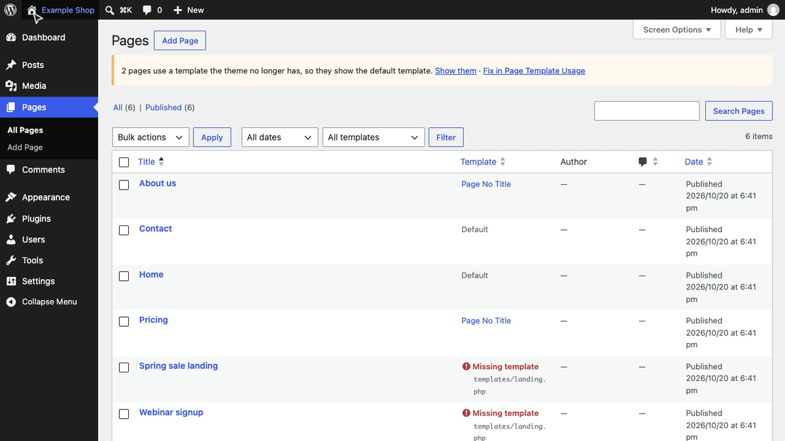
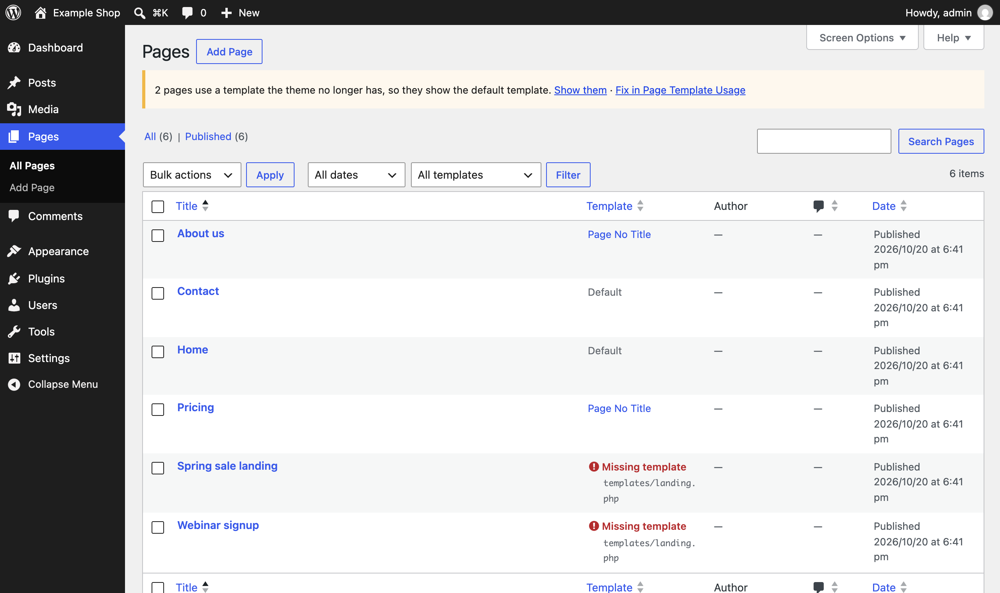
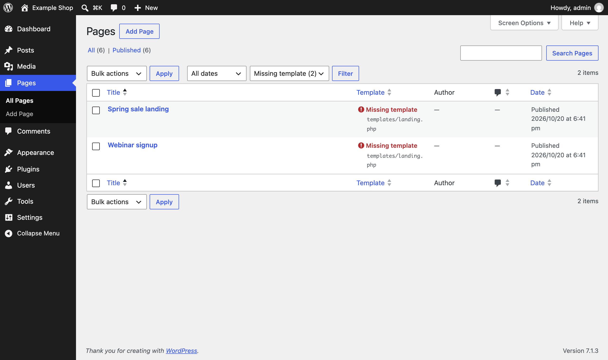
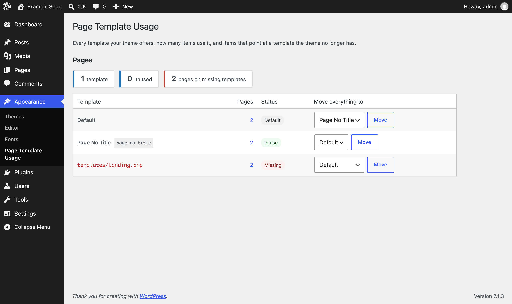

<p align="center"></p>

<h1 align="center">Page Template Usage</h1>

<p align="center">
  <a href="https://playground.wordpress.net/?blueprint-url=https://raw.githubusercontent.com/aryanjasala/page-template-usage/main/blueprint.json"></a>
  <a href="https://github.com/aryanjasala/page-template-usage/releases/latest"></a>
  
  
  <a href="LICENSE.md"></a>
  <br>
  <a href="https://github.com/aryanjasala/page-template-usage/actions/workflows/phpcs.yml"></a>
  <a href="https://github.com/aryanjasala/page-template-usage/actions/workflows/phpstan.yml"></a>
  <a href="https://github.com/aryanjasala/page-template-usage/actions/workflows/unit-tests.yml"></a>
  <a href="https://github.com/aryanjasala/page-template-usage/actions/workflows/e2e-tests.yml"></a>
  <a href="https://github.com/aryanjasala/page-template-usage/actions/workflows/plugin-check.yml"></a>
</p>

<p align="center">See which template every page uses, and find the ones pointing at templates that no longer exist.</p>

<p align="center">
  
</p>

---

WordPress lets you pick a template for each page but never shows which one is in use. After a theme switch, or a renamed or deleted template file, pages silently fall back to the default template. Page Template Usage puts the template on the Pages list, counts how many pages use each one, and moves pages off a template in one click.

> [!NOTE]
> Free and open source under the GPL. No pro version, no upsells, no ads in wp-admin, no tracking. And it stays that way.

## Features

- **Template column** on Pages, and on any post type with templates, linked to everything else on that template
- **Filter with counts**: every template the theme offers and how many pages use it, so 0 means unused
- **Sort** the list by template
- **Missing templates** flagged in red, with a notice above the list
- **Appearance > Page Template Usage**: every template on one screen, with a one-click **Move everything to** for each
- Classic themes (PHP templates, `Template Post Type`) and block themes (`theme.json` and Site Editor templates)
- No settings, nothing stored in the database

## Install

1. Download `page-template-usage.zip` from the [latest release](https://github.com/aryanjasala/page-template-usage/releases/latest).
2. In WordPress, go to **Plugins > Add New Plugin > Upload Plugin**, choose the zip and activate it.

Or with WP-CLI:

```sh
wp plugin install https://github.com/aryanjasala/page-template-usage/releases/latest/download/page-template-usage.zip --activate
```

Needs WordPress 6.6+ and PHP 7.4+. To try it first, the **Try in WordPress Playground** badge opens a throwaway WordPress in your browser with the plugin and some demo content.

## Quick look

Find every page on a template the theme no longer has, then move them all to the default template:

```sh
wp page-template-usage list --status=missing
wp page-template-usage reassign missing default
```

## Screenshots

<table>
  <tr>
    <td width="50%" valign="top"><br><sub>The Template column and filter on the Pages screen</sub></td>
    <td width="50%" valign="top"><br><sub>A page whose template no longer exists</sub></td>
  </tr>
  <tr>
    <td width="50%" valign="top"> Page Template Usage"><br><sub>Appearance > Page Template Usage</sub></td>
  </tr>
</table>

## Documentation

| Doc | What it covers |
| --- | --- |
| [Reference](docs/REFERENCE.md) | WP-CLI commands and the PHP API |
| [Development](docs/DEVELOPMENT.md) | Local setup, commands and tests |
| [Contributing](docs/CONTRIBUTING.md) | Pull requests, required checks and PR titles |
| [Releasing](docs/RELEASING.md) | How merged pull requests become releases |
| [Security](docs/SECURITY.md) | Reporting a vulnerability |
| [readme.txt](readme.txt) | What WordPress.org shows, with the FAQ and changelog |

## Project structure

```
page-template-usage.php    plugin header and PSR-4 autoloader
src/
├── Plugin.php               creates the services
├── Templates.php            templates, usage counts, reassigning
├── Admin/
│   ├── ListColumn.php       column, filter, sorting, missing-template notice
│   └── ReportPage.php       Appearance > Page Template Usage
└── Cli/Command.php          wp page-template-usage
assets/admin.css
tests/
├── Unit/                    PHPUnit
└── e2e/                     Playwright specs and the Docker site
.wordpress-org/              screenshots
docs/                        reference, development, contributing, releasing
```

## More free plugins

Small plugins that each fill one gap in WordPress, all free with no pro version:

| | Plugin | What it does |
| --- | --- | --- |
|  | [Staging Guard](https://github.com/aryanjasala/staging-guard) | Stops staging copies from emailing real people or getting indexed |
|  | [Category & Tag Trash](https://github.com/aryanjasala/category-tag-trash) | A trash for categories, tags and custom terms, with undo and full restore |
|  | [Axle Read-Only Mode](https://github.com/aryanjasala/axle-read-only-mode) | Read-only mode for WordPress during migrations and deploys |
|  | [Restore Blocks from Revisions](https://github.com/aryanjasala/restore-blocks-from-revisions) | Restore a single block from an old revision, not the whole post |
|  | [Activity Log with Undo](https://github.com/aryanjasala/activity-log-with-undo) | An activity log where every change you can reverse has an Undo button |
|  | [Agent Governance](https://github.com/aryanjasala/agent-governance) | Hold risky AI agent calls for approval, preview what they change, and roll back a session |
|  | [Block Doctor](https://github.com/aryanjasala/block-doctor) | Scan the whole site for invalid and broken blocks and fix them in bulk, with undo |
|  | [Block Theme Ops](https://github.com/aryanjasala/block-theme-ops) | Find Site Editor changes that override your theme files, see the diff, reset them or send them to Git |
|  | [Role Right-Sizer](https://github.com/aryanjasala/role-right-sizer) | Recommends the smallest role each user needs, from what they actually do |
|  | [Update Rehearsal](https://github.com/aryanjasala/update-rehearsal) | Try plugin, theme, core and PHP updates on a disposable copy of your site in WordPress Playground first |
|  | [User Session Manager](https://github.com/aryanjasala/user-session-manager) | See every device signed in, sign out one, and limit sessions per role |

## License

Copyright Aryan Jasala. Licensed under [GPL-2.0-or-later](LICENSE.md).
